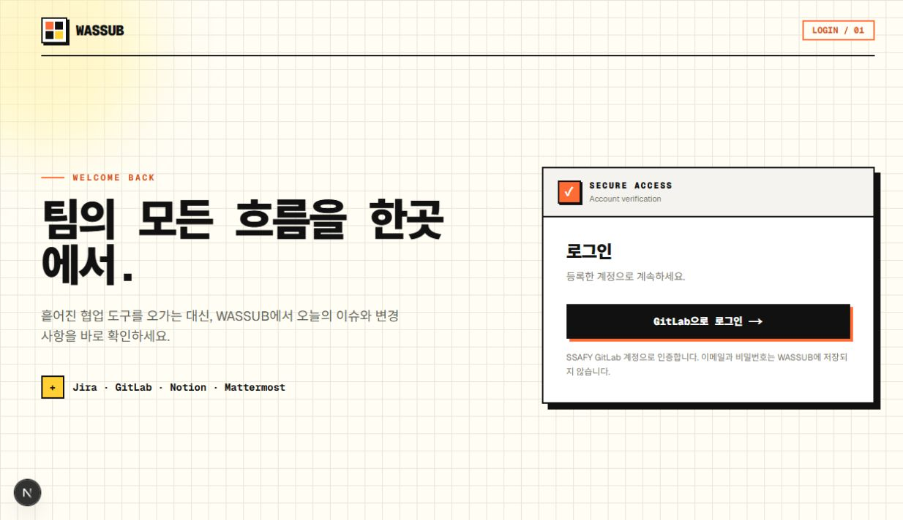
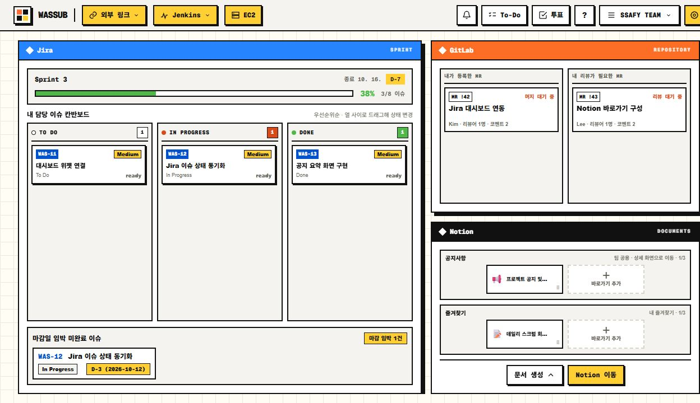
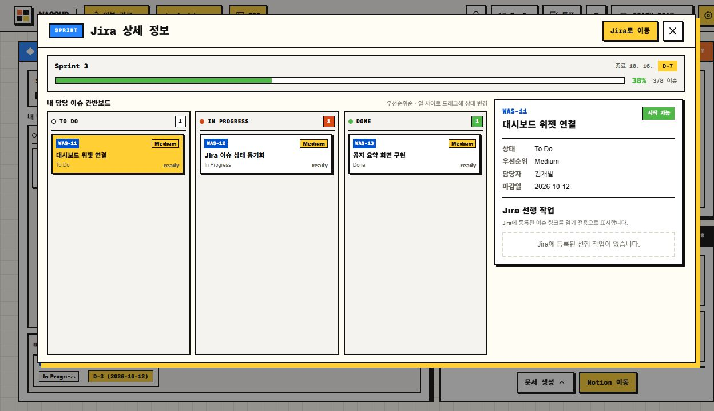
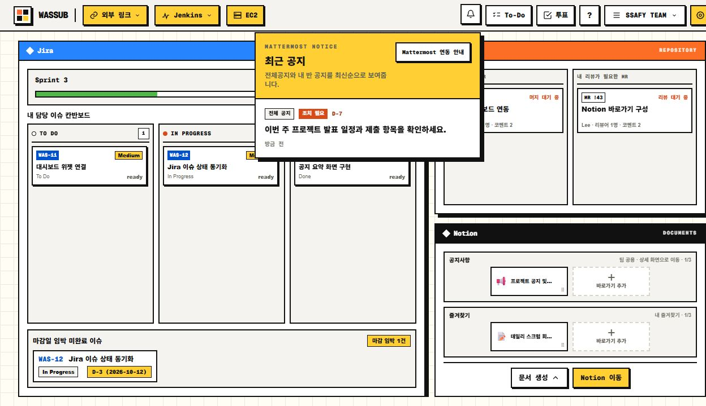

# WASSUB | SSAFY 협업 워크스페이스

[日本語版](./portfolio.ja.md)

GitLab, Jira, Notion, Mattermost, Jenkins에 흩어진 팀 작업 정보를 한 화면에서 확인하는 웹 서비스입니다. 팀은 GitLab 프로젝트로 워크스페이스를 만들고, 대시보드에서 이슈·MR·문서·공지·빌드 상태를 살펴본 뒤 필요한 상세 작업으로 이동합니다.

> 이 문서는 원본 프로젝트 저장소의 구현 코드와 시연 시나리오를 기준으로 서비스 흐름을 정리한 포트폴리오입니다. 기획 문서의 MVP 목표 전체를 완료 기능으로 취급하지 않았습니다. 아래 캡처는 실제 프론트엔드를 로컬에서 실행한 화면입니다. 로그인 화면 외의 데이터는 별도 시연용 API 응답으로 채웠으며, 실제 서비스 계정의 연동 결과나 운영 성과를 증명하는 자료는 아닙니다.

> 구현 자료 링크는 원본 GitLab 저장소를 가리키며 접근 권한이 필요할 수 있습니다.



*로컬 실행 화면 · GitLab 로그인 진입점*

## 1. 전체 서비스 흐름

| 단계 | 사용자 경험 | 시스템 처리 |
|---|---|---|
| 로그인·온보딩 | GitLab으로 로그인하고 참여할 프로젝트를 선택 | OAuth 로그인, 프로젝트 발견, 워크스페이스 생성 또는 참여 |
| 도구 연결 | Jira·Notion·Jenkins 등 팀 도구를 연결 | 워크스페이스 권한 확인, 외부 토큰과 웹훅 설정 관리 |
| 통합 대시보드 | 이슈, MR, 문서, 공지, 빌드 상태 확인 | 외부 API 조회 결과와 저장된 이벤트를 위젯에 반영 |
| 작업 확인 | 항목의 상세 내용 또는 원본 페이지 열기 | 필요한 정보는 서비스 안에서 보여주고 원본 도구의 링크로 연결 |
| 실시간 갱신 | MR·빌드·공지 변경을 화면에서 확인 | 웹훅 수신 후 워크스페이스별 SSE 이벤트 전달 |
| 운영 상태 확인 | EC2 자원과 컨테이너 상태 조회 | 설치된 Go 에이전트가 주기적으로 메트릭을 수집·전송 |

### GitLab 프로젝트가 워크스페이스가 되는 과정

1. GitLab OAuth 로그인 후, 아직 참여한 워크스페이스가 없는 사용자에게 프로젝트 탐색용 일회성 setup ticket을 발급합니다.
2. 사용자가 프로젝트를 선택하면 서버가 Maintainer 권한과 프로젝트 상태를 다시 검사합니다.
3. 워크스페이스를 만들면서 GitLab Project Access Token을 발급해 대시보드 조회에 사용합니다.
4. 같은 프로젝트의 다른 사용자는 후보로 등록되며, 로그인 후 직접 참여합니다. 후보라는 이유만으로 자동 가입되지는 않습니다.

이 흐름은 프로젝트 탐색에 쓰는 사용자 OAuth 토큰과 팀 대시보드 조회에 쓰는 워크스페이스 토큰의 역할을 나눕니다. 워크스페이스 생성 흐름

## 2. 핵심 기능 — 협업 대시보드



*로컬 실행 화면 · Jira 칸반, GitLab MR, Notion 바로가기 (시연용 데이터)*

| 영역 | 화면에서 할 수 있는 일 | 구현 경로 |
|---|---|---|
| Jira | 스프린트 요약·칸반·마감 임박 이슈를 확인하고 이슈 상태 변경 | Jira 프론트엔드, Jira 연동 |
| GitLab | 열린 MR, 리뷰 대기 항목, 커밋과 저장소 정보를 확인 | GitLab 대시보드 흐름 |
| Notion | 팀의 중요 페이지와 개인 즐겨찾기를 등록·조회하고 페이지 상세 확인 | Notion 연동 흐름 |
| Mattermost | 전체·반별 공지를 읽고 AI 요약을 확인 | 공지 분석 흐름 |
| Jenkins | Job과 빌드 결과를 확인하고 실패 로그 분석 결과 조회 | Jenkins 연동 흐름 |

대시보드는 각 도구의 원본 데이터를 모아 현재 상태를 파악하는 진입점입니다. GitLab 조회 API는 워크스페이스 멤버십과 토큰 상태를 검사하고, Jira·Notion 등은 도구별 연결 상태를 따로 관리합니다. 위젯의 항목은 가능한 경우 원본 도구의 상세 페이지로 연결합니다.



*로컬 실행 화면 · 스프린트 진행률, 칸반, 선택한 이슈 상세 (시연용 데이터)*

### 변경 사항을 전달하는 경로

```text
GitLab · Jenkins · Mattermost 웹훅
                 ↓
        Spring Boot 수신·검증
                 ↓
      저장 및 워크스페이스 이벤트
                 ↓
            SSE → 웹 화면
```

Jenkins 빌드 상태는 웹훅으로 즉시 알리고, 커밋 상태는 GitLab에도 기록해 재조회할 수 있게 했습니다. 화면이 이벤트를 놓쳐도 저장된 상태와 외부 도구를 통해 현재 정보를 다시 확인할 수 있는 구조입니다. SSE 설계, Jenkins 연동

## 3. 핵심 기능 — AI 어시스트

### MR 사전 리뷰

GitLab MR 웹훅을 받은 Spring 서버가 FastAPI에 리뷰 작업을 접수합니다. AI 서비스의 작업자는 대기 중인 작업을 점유한 뒤 필요한 GitLab 자격 증명을 서버에서 받아 MR 변경 내용을 분석합니다. 결과는 Spring으로 콜백하고, Spring이 GitLab 코멘트 작성과 대시보드 조회를 담당합니다. 접수 응답과 리뷰 완료를 별도 상태로 취급합니다. MR 리뷰 구현 문서

### 빌드 로그와 공지 분석

- Jenkins 빌드 실패 로그는 AI 분석 작업으로 전달해 원인 파악을 돕는 요약을 제공합니다. 분석 코드
- Mattermost 공지는 서버가 먼저 저장하고, 커밋 후 AI 서비스에 요약·키워드·조치 필요 여부·마감일 추출을 맡깁니다. 분석 결과는 콜백으로 공지 상태에 반영됩니다. 공지 분석 흐름



*로컬 실행 화면 · 공지 요약과 조치 필요 여부 표시 (시연용 데이터)*

AI 서비스는 분석 결과를 생성하고, 웹훅 검증·권한 확인·외부 서비스에 쓰기는 Spring 서버가 담당합니다.

## 4. 핵심 기능 — EC2 모니터링

팀 EC2에 설치하는 Go 에이전트가 CPU, 메모리, 디스크, 네트워크 누적량, load average, uptime, Docker 컨테이너 목록과 지정된 URL의 헬스체크 결과를 수집합니다. 에이전트는 HTTPS로 메트릭을 보내고, Spring 서버가 토큰으로 워크스페이스를 식별해 저장·조회하며, 화면에서 이를 시각화합니다.

에이전트 설치 스크립트는 systemd 서비스를 등록합니다. 기본 수집 간격은 60초입니다. 전송 실패 시 재시도·버퍼링은 구현 범위에 포함되지 않아 다음 주기의 전송으로 이어집니다. 에이전트 구현 범위

## 5. 시스템 구성

| 구성 요소 | 기술 | 역할 |
|---|---|---|
| 웹 | Next.js 16, React 19, TypeScript | 로그인·설정·대시보드·상세 화면 |
| API | Java 21, Spring Boot 4.1 | 인증·워크스페이스·도구 연동·웹훅·SSE |
| AI | Python 3.12+, FastAPI | MR 리뷰, 빌드 로그·공지 분석 |
| 에이전트 | Go, gopsutil | EC2 메트릭·헬스체크 수집 |
| 저장소 | PostgreSQL, Redis | 서비스 데이터와 AI 작업 상태, 인증 관련 임시 상태 |
| 배포 | Docker Compose, Jenkins | 서비스 컨테이너와 CI/CD 구성 |

```text
브라우저(Next.js)
    ↕ REST / SSE
Spring Boot ── PostgreSQL · Redis
    ├─ GitLab · Jira · Notion API
    ├─ GitLab · Jenkins · Mattermost 웹훅 수신
    ├─ FastAPI → LLM 게이트웨이
    └─ Go 에이전트 ← EC2 메트릭
```

## 6. 설계에서 중요하게 다룬 문제

| 문제 | 적용한 방식 |
|---|---|
| 팀 데이터의 접근 범위 | 모든 조회·변경에 워크스페이스 멤버십을 확인하고, 연결·해제 등 관리 작업은 OWNER 권한으로 제한 |
| 외부 서비스 자격 증명 | GitLab 조회용 토큰을 워크스페이스 단위로 관리하고, Notion 토큰은 암호화해 저장 |
| 실시간 이벤트 누락 | SSE는 변경 알림에 사용하고, 조회 API와 외부 도구의 상태로 화면을 다시 구성 |
| 느린 AI 처리 | 웹훅 수신·작업 접수와 AI 분석 완료를 분리하고 결과를 콜백으로 반영 |
| EC2 내부 서비스 접근 | Jenkins가 서비스 서버로 웹훅을 보내도록 구성하고, EC2 메트릭도 에이전트가 외부로 push |

## 7. 확인 가능한 범위

원본 프로젝트 저장소에는 프론트엔드, 백엔드, AI 서비스, 에이전트, 배포 설정과 시연 시나리오가 있습니다. 화면 캡처는 프론트엔드 렌더링과 사용자 흐름을 보여주며, 외부 서비스와의 실제 연결 성공을 검증한 자료는 아닙니다. 운영 성과, 처리량 개선 수치, 실제 사용자 반응은 근거 자료가 추가되면 별도로 기재할 수 있습니다.
